# Bluryy Flagship Feature Hierarchy & Decompiled Code Proof Map

This document establishes the reverse-engineered hierarchical map of all flagship features unlocked by `Bluryyv2.9.zip` across the **Android Framework**, **SystemUI**, **Launcher**, and **SurfaceFlinger**.

Each feature is traced from its **Supreme Value** (system property or XML app feature) down through the intercepting classes, exact methods, parameters, and conditional branches, providing verified decompiled source code proofs.

---

## 1. Architectural Overview & Value Flow

```mermaid
flowchart TD
    subgraph SupremeValues["Supreme Properties & XML Features"]
        P1["ro.oplus.animationlevel"]
        P2["ro.oplus.gaussianlevel"]
        P3["persist.sys.oplus.systemui.dynamic_blur"]
        P4["persist.sys.oplus.anim_level"]
        P5["persist.sys.oplus.upgrade_anim_level"]
        P6["persist.sys.wallpaperanimation.enable"]
        P7["oplus_customize_settings_zoom_wallpaper_enable"]
        P8["ro.oplus.display.disable.volume_blur / com.android.systemui.volume_dynamic_blur.enable"]
        P9["com.oplus.systemui.panoramic_aod.enable"]
        P10["oplus.software.adaptive_smooth_animation"]
        P11["ro.surface_flinger.supports_background_blur"]
    end

    subgraph FrameworkLayer["Android Framework Layer (framework.jar / oplus-framework.jar)"]
        F1["OplusPlatformLevelUtils.java<br/>getPlatformAnimationLevel()<br/>getPlatformGaussianLevel()"]
        F2["OplusAnimationUtils.java<br/>getPlatformAnimation()"]
        F3["OplusAnimationController.java<br/>getPlatformLevelAnimation()<br/>mNeedWindowCornerRadius = true"]
        F4["OplusSmoothRoundedManager.java<br/>SMOOTH_ON (Squircle Curves)"]
        F5["OplusShellStartingWindowUtils.java<br/>ENABLE_ADAPTIVE_SMOOTH_ANIM_TRANSITION"]
    end

    subgraph SystemUILayer["SystemUI Layer (SystemUI.apk)"]
        S1["PlatformBlurManagerImpl.java<br/>useMotionBlur() -> MOTION_120 (120Hz Blur)"]
        S2["ScrimControllerExImp.java<br/>adjudgeScrimBehindBlurType() -> BlurTypePlatformStatic"]
        S3["ViewBlurManager.java<br/>decideBlurType() / blurForHeadsUp()"]
        S4["VolumeFeatureOption.java<br/>isVolumeDynamicBlurEnable()"]
        S5["ImageWallpaperExImpl.java<br/>shouldZoomOutWallpaper()"]
        S6["AodFeatureOption.java<br/>isPanoramicAODFeatureEnable -> OplusPanoramicAodRepository"]
    end

    subgraph LauncherLayer["Launcher Layer (OplusLauncher.apk)"]
        L1["PlatformLevelUtils.java & LauncherAnimConfig.java<br/>isLevelAPlus() / isLevelA()"]
        L2["OplusBlurProperties.java<br/>isSupportDrawerBlur() (Live Drawer Blur)"]
        L3["OplusStackRecentsConfig.java<br/>isAnimLevelSupportedStack() (Recents Card Stack)"]
        L4["FeatureOption.java<br/>isSupporNewWallpaperAnimation"]
        L5["LauncherAnimConfig.java<br/>isWallpaperAnimDisable() = false"]
    end

    P1 --> F1
    P2 --> F1
    F1 --> F2
    F1 --> F3
    F1 --> S1
    F1 --> S2
    F1 --> S3
    P3 --> S1
    P4 --> L1
    L1 --> L2
    L1 --> L3
    L1 --> L5
    P5 --> F4
    P6 --> L4
    P7 --> S5
    P8 --> S4
    P9 --> S6
    P10 --> F5
```



---

## 2. Framework Animation & Gaussian Level (Global Supreme Values)

### 2.1 `ro.oplus.animationlevel`
* **Supreme Definition**: Read by `com.oplus.util.OplusPlatformLevelUtils` to classify device tier into `1` (Low / Light OS), `2` (Mid-range / Standard), or `3` (Flagship / Rich Bezier).
* **Decompiled Source Proof** (`OplusPlatformLevelUtils.java:32, 188`):
```java
private static final int ANIMATION_LEVEL = SystemProperties.getInt("ro.oplus.animationlevel", 0);

public int getPlatformAnimationLevel() {
    int i = ANIMATION_LEVEL;
    if (i >= 1 && i <= 3) {
        return i;
    }
    if (IS_LIGHT_OS) {
        return 1;
    }
    int i2 = sGpuLevel;
    if (i2 == 2 || i2 == 3) {
        return i2;
    }
    return 3;
}
```

#### Downstream Branch A: Fluid Window Launch / Exit Curves
* **Intercepting Class**: `android.view.animation.OplusAnimationUtils`
* **Method**: `getPlatformAnimation(Context context, int resId)`
* **Code Proof**:
```java
public static int getPlatformAnimation(Context context, int resId) {
    int platformLevel = OplusPlatformLevelUtils.getInstance().getPlatformAnimationLevel();
    if (platformLevel == 1) {
        // Degrades rich cubic Bezier animations to low-cost fade transitions
        if (resId == 201982014) return 201982011;
        if (resId == 201982015) return 201982012;
    }
    // High tier (2 or 3): Returns full fluid ColorOS physics-based transitions
    return resId;
}
```
* **Visual Effect**: At tier 2/3, opening and closing applications uses smooth exponential cubic-bezier motion curves instead of instantaneous fade cuts.

#### Downstream Branch B: Hardware Window Scaling & Rounded Corners
* **Intercepting Class**: `com.oplus.transition.OplusAnimationController`
* **Method**: `getPlatformLevelAnimation(Context context, int styleResId)`
* **Code Proof**:
```java
public static Animation getPlatformLevelAnimation(Context context, int styleResId) {
    int platformLevel = OplusPlatformLevelUtils.getInstance().getPlatformAnimationLevel();
    if (platformLevel == 1) {
        return sAnimMapLowEnd.get(styleResId);
    }
    // Unlocks window hardware scaling and rounded corners during app transitions
    mNeedWindowCornerRadius = true;
    return sAnimMapHighEnd.get(styleResId);
}
```
* **Visual Effect**: Floating app windows scale with hardware-accelerated rounded corners (`mNeedWindowCornerRadius`) rather than sharp rectangular borders.

---

### 2.2 `ro.oplus.gaussianlevel`
* **Supreme Definition**: Read by `OplusPlatformLevelUtils` to determine GPU blur tier: `1` (No Blur / Flat Color), `2` (Static Backdrop Blur), or `3` (120Hz Hardware Motion Blur).
* **Decompiled Source Proof** (`OplusPlatformLevelUtils.java:33, 201`):
```java
private static final int GAUSSIAN_LEVEL = SystemProperties.getInt("ro.oplus.gaussianlevel", 0);

public int getPlatformGaussianLevel() {
    int i = GAUSSIAN_LEVEL;
    if (i >= 1 && i <= 3) {
        return i;
    }
    int i2 = sGpuLevel;
    if (i2 != -1) {
        return i2;
    }
    return 3;
}
```

* **Downstream Callers in SystemUI Scrim** (`ScrimUtil.java:102-120`):
```java
public static final boolean isHighGaussianLevel(Context context) {
    return OplusPlatformLevelUtils.getInstance().getPlatformGaussianLevel() == 3;
}

public static final boolean isMiddleGaussianLevel(Context context) {
    return OplusPlatformLevelUtils.getInstance().getPlatformGaussianLevel() == 2;
}

public static final boolean isLowGaussianLevel(Context context) {
    return OplusPlatformLevelUtils.getInstance().getPlatformGaussianLevel() == 1;
}
```

---

### 2.3 `persist.sys.oplus.upgrade_anim_level` (Squircle Curves)
* **Supreme Definition**: Read by `OplusSmoothRoundedManager` in framework.
* **Decompiled Source Proof** (`OplusSmoothRoundedManager.java:18-24`):
```java
private static final int ANIM_LEVEL = SystemProperties.getInt(OplusViewSeamlessRemoteManager.OPLUS_ANIMATION_LEVEL_PROP, 3);
private static final int UPGRADE_ANIM_LEVEL = SystemProperties.getInt("persist.sys.oplus.upgrade_anim_level", 3);

static {
    // When level < 3 (e.g. level 2 or 1), enables mathematical squircle curves across all Android Views
    SMOOTH_ON = (ANIM_LEVEL < 3 || UPGRADE_ANIM_LEVEL < 3) && DEFAULT_WEIGHT != 2.0f;
}
```
* **Visual Effect**: Enables continuous curvature (squircle) on all rounded corners across SystemUI dialogs, cards, and windows instead of standard concentric circles.

---

### 2.4 `oplus.software.adaptive_smooth_animation` (WMS Shell Morphing)
* **Supreme Definition**: XML feature flag read by WindowManager Shell.
* **Decompiled Source Proof** (`OplusShellStartingWindowUtils.java:51-55`):
```java
boolean z3 = z || OplusFeatureConfigManager.getInstance().hasFeature("oplus.software.adaptive_smooth_animation");
ENABLE_ADAPTIVE_SMOOTH_ANIM_TRANSITION = z3;
HIGH_PERFORMANCE_ANIM_LEVEL = z3 && (animLevel == 1 || animLevel == 2);
LIGHT_OS_ANIM_LEVEL = z3 && (animLevel == 3 || animLevel == 4);
```
* **Visual Effect**: When `HIGH_PERFORMANCE_ANIM_LEVEL` is true, starting splash windows seamlessly morph directly into application layouts with interruptible swipe-to-dismiss gesture tracking.

---

## 3. SystemUI Subsystem (Shade, Blur, Scrim & AOD)

### 3.1 `persist.sys.oplus.systemui.dynamic_blur` (120Hz Hardware Motion Blur)
* **Supreme Definition**: Controls live real-time blur during notification panel / quick settings expansion.
* **Decompiled Source Proof** (`PlatformBlurManagerImpl.java:447`):
```java
public final boolean useMotionBlur() {
    if (((Boolean) this.forceStopMotionBlur.getValue()).booleanValue()) {
        return false;
    }
    return (ScrimUtil.isHighGaussianLevel(this.context) || "true".equals(ScrimUtil.ANIM_DYNAMIC_BLUR))
        && ((Boolean) this.materialBlurStateManager.getEnableMaterialBlur().getValue()).booleanValue()
        && !GaussBlurUtils.isGaussBlurDisabled();
}
```
* **Downstream Trigger** (`PlatformBlurManagerImpl.java:470`):
```java
int blurFrequency = (((Boolean) getUseMotionBlur().getValue()).booleanValue() && this.isExpanding)
    ? PlatformBlurManager.PlatformBlurMode.MOTION_120.getBlurFrequency(this)
    : platformBlurMode.getBlurFrequency(this);

Blur.setBlurFrequency(applicationContext, blurFrequency);
Blur.resumeWindowBlur(context);
```
* **Visual Effect**: Forces **120Hz hardware window blur** (`MOTION_120`) behind the Quick Settings panel during active pull-down swipes.

---

### 3.2 Dynamic Backdrop Blur Behind Quick Settings & Shade
* **Intercepting Class**: `com.oplus.systemui.statusbar.phone.ScrimControllerExImp`
* **Method**: `adjudgeScrimBehindBlurType()`
* **Decompiled Source Proof** (`ScrimControllerExImp.java:371-395`):
```java
if ((ScrimUtil.isLowGaussianLevel(this.context) && !ScrimUtil.isLightOsGaussianLevel()) || GaussBlurUtils.isGaussBlurDisabled()) {
    blurTypeNon = ViewBlurProxy.BlurType.BlurTypeNon.INSTANCE; // Degrades to flat grey!
} else if (this.isEnteringBouncer || getScrimController().getState() == ScrimState.BOUNCER) {
    blurTypeNon = KeyguardFeatureOption.isDisableBouncerBlurScrim
        ? ViewBlurProxy.BlurType.BlurTypeNon.INSTANCE
        : ViewBlurProxy.BlurType.BlurTypePlatformStatic.INSTANCE;
} else {
    blurTypeNon = ViewBlurProxy.BlurType.BlurTypePlatformStatic.INSTANCE; // Full Dynamic GPU Backdrop Blur!
}
viewBlurProxy.setBlurType(blurTypeNon);
```
* **Visual Effect**: Swapping from `BlurTypeNon` to `BlurTypePlatformStatic` replaces the dull flat gray curtain with translucent frosted glass.

---

### 3.3 Notification Rows & HeadsUp Blur
* **Intercepting Class**: `com.oplus.systemui.notification.blur.ViewBlurManager`
* **Method**: `decideBlurType()` & `blurForHeadsUp()`
* **Decompiled Source Proof** (`ViewBlurManager.java:312`):
```java
public final ViewBlurProxy.BlurType decideBlurType() {
    if (!GaussBlurUtils.isGaussBlurDisabled() && !ScrimUtil.isLowGaussianLevel(this.context)) {
        if (!ScrimControllerEx.isThirdTheme) {
            return ViewBlurProxy.BlurType.BlurTypePlatformStatic.INSTANCE;
        }
    }
    return ViewBlurProxy.BlurType.BlurTypeNon.INSTANCE;
}
```
* **For HeadsUp Banners**:
```java
public final void blurForHeadsUp(ViewBlurProxy viewBlurProxy) {
    if (ScrimUtil.isHighGaussianLevel(this.context) || ScrimUtil.isMiddleGaussianLevel(this.context)) {
        viewBlurProxy.setBlurType(ViewBlurProxy.BlurType.BlurTypeMotion.INSTANCE);
    } else {
        viewBlurProxy.setBlurType(ViewBlurProxy.BlurType.BlurTypeNon.INSTANCE);
    }
}
```
* **Visual Effect**: Individual notification rows and incoming heads-up banners render with real-time blurred glass backing.

---

### 3.4 Volume Slider Dynamic Blur
* **Supreme Flags**: `ro.oplus.display.disable.volume_blur` & `com.android.systemui.volume_dynamic_blur.enable`
* **Intercepting Class**: `com.oplusos.systemui.common.feature.VolumeFeatureOption`
* **Decompiled Source Proof** (`VolumeFeatureOption.java:24, 49`):
```java
private static final String FEATURE_ENABLE_VOLUME_DYNAMIC_BLUR = "com.android.systemui.volume_dynamic_blur.enable";
public static boolean sIsVolumeDynamicBlurEnable;

public static boolean isVolumeDynamicBlurEnable() {
    return ((Boolean) isVolumeDynamicBlurEnable$delegate.getValue()).booleanValue();
}

public final void loadAppFeature(Context context) {
    sIsVolumeDynamicBlurEnable = AppFeatureProviderUtils.getBoolean(
        context.getContentResolver(), FEATURE_ENABLE_VOLUME_DYNAMIC_BLUR, false
    );
}
```
* **Visual Effect**: When enabled, the volume slider panel renders with real-time background blur instead of an opaque solid pill background.

---

### 3.5 Panoramic AOD (Full Screen Lockscreen Depth AOD)
* **Supreme Flag**: `com.oplus.systemui.panoramic_aod.enable`
* **Intercepting Class**: `com.oplusos.systemui.common.feature.AodFeatureOption`
* **Decompiled Source Proof** (`AodFeatureOption.java:39, 126`):
```java
private static final String OPLUS_PANORAMIC_AOD_ENABLE = "com.oplus.systemui.panoramic_aod.enable";
public static boolean isPanoramicAODFeatureEnable;

public final void loadAppFeature(Context context) {
    isPanoramicAODFeatureEnable = AppFeatureProviderUtils.getBoolean(
        context.getContentResolver(), OPLUS_PANORAMIC_AOD_ENABLE, false
    );
}
```
* **Downstream Handlers**: `OplusPanoramicAodRepository` and `AodNotificationCoordinator`.
* **Visual Effect**: Unlocks full-screen panoramic Always-On Display with depth wallpaper transitions between AOD, Lockscreen, and Home.

---

### 3.6 Wallpaper Zoom-Out Interaction
* **Supreme Setting**: `oplus_customize_settings_zoom_wallpaper_enable`
* **Intercepting Class**: `com.oplus.systemui.wallpapers.ImageWallpaperExImpl`
* **Decompiled Source Proof** (`ImageWallpaperExImpl.java:40, 189`):
```java
private static final String SETTINGS_SHOULD_ZOOM_WALLPAPER_KEY = "oplus_customize_settings_zoom_wallpaper_enable";

public boolean shouldZoomOutWallpaper(Context context, int i) {
    boolean z = false;
    boolean z2 = (i & 2) != 0 && ((OplusWallpaperAnimControllerImpl) this.oplusWallpaperAnimControllerImpl.get()).isEnableZoomOutWallpaper();
    if ((context == null || context.getDisplayId() != 1 || !this.isDisableRemapDisplay) && (this.shouldZoomOutWallpaper == 1 || z2)) {
        z = true;
    }
    return z;
}
```
* **Visual Effect**: The home and lockscreen wallpaper smoothly zooms outward in 3D perspective during notification shade expansion and gesture returns.

---

## 4. Oplus Launcher Subsystem

### 4.1 `persist.sys.oplus.anim_level` (Launcher Performance Tier)
* **Supreme Definition**: Read by `com.android.common.util.PlatformLevelUtils` and `LauncherAnimConfig`:
  - `1` = Tier A+ (Flagship)
  - `2` = Tier A (High End)
  - `3` = Tier B+ (Mid-range)
  - `4` = Tier B (Low End)

```mermaid
graph LR
    P4["persist.sys.oplus.anim_level"] --> LConfig["LauncherAnimConfig"]
    LConfig -->|isLevelAPlus (Level 1)| Drawer["Live Drawer Blur<br/>(isSupportDrawerBlur)"]
    LConfig -->|isLevelA or APlus (Level 1 or 2)| Stack["Recents Stack Layout<br/>(isAnimLevelSupportedStack)"]
    LConfig -->|isLevelBOrBPlus (Level 3 or 4)| ZoomDis["Wallpaper Anim Disabled<br/>(isWallpaperAnimDisable = true)"]
```

#### Downstream Branch A: Live App Drawer Gaussian Blur
* **Intercepting Class**: `com.android.launcher3.util.OplusBlurProperties`
* **Method**: `isSupportDrawerBlur()`
* **Decompiled Source Proof**:
```java
public final boolean isSupportDrawerBlur() {
    return LauncherAnimConfig.isLevelAPlus() && getSysMaterialBlurSwitchEnable();
}
```
* **Root Cause of Interference**: When `persist.sys.oplus.anim_level` was set to `1`, App Drawer live blur was forced on automatically, even if no drawer blur was chosen by the user! Decoupling this requires hooking `isSupportDrawerBlur()` directly.

#### Downstream Branch B: Recents Overview Layout Tier
* **Intercepting Class**: `com.oplus.quickstep.layout.stack.OplusStackRecentsConfig`
* **Method**: `isAnimLevelSupportedStack()`
* **Decompiled Source Proof**:
```java
public final boolean isAnimLevelSupportedStack() {
    return PlatformLevelUtils.isAnimationLevel(2) || PlatformLevelUtils.isAnimationLevel(1);
}
```
* **Root Cause of Interference**: Setting `anim_level` to `1` or `2` immediately switches Recents Overview to the Stack Layout if the launcher XML flag allows it. Decoupling this allows users to choose Grid or Stack independently of their animation tier.

#### Downstream Branch C: Wallpaper Zoom Motion
* **Intercepting Class**: `com.android.launcher3.anim.LauncherAnimConfig`
* **Method**: `isWallpaperAnimDisable()`
* **Decompiled Source Proof**:
```java
public static final boolean isWallpaperAnimDisable() {
    return isLevelBOrBPlus();
}
```
* **Visual Effect**: When tier is A or A+ (`1` or `2`), `isWallpaperAnimDisable()` returns `false`, enabling fluid wallpaper scaling when entering Recents or launching apps.

---

### 4.2 `persist.sys.wallpaperanimation.enable` (Launcher New Wallpaper Engine)
* **Intercepting Class**: `com.android.common.config.FeatureOption`
* **Decompiled Source Proof** (`FeatureOption.java:296, 1131`):
```java
private static final String WALLPAPER_ANIMATION_SIGN = "persist.sys.wallpaperanimation.enable";
public static boolean isSupporNewWallpaperAnimation = false;

// In initialization:
isSupporNewWallpaperAnimation = SystemProperties.getBoolean(WALLPAPER_ANIMATION_SIGN, false);
```
* **Visual Effect**: Engages the parallel hardware wallpaper anim pipeline during home gesture flings.

---

### 4.3 Modern Folder & Popup Material Blur
* **Supreme Flag**: `com.oplus.blur.support_upgrade_anim_material_blur`
* **Intercepting Class**: `com.android.launcher3.util.OplusBlurProperties`
* **Method**: `isSupportNewBlur()` & `FolderAnimUtil`
* **Visual Effect**: Unlocks translucent glass shaders for folders and app shortcut popups instead of solid gray backgrounds.

---

## 5. Native SurfaceFlinger Subsystem

* **`ro.surface_flinger.supports_background_blur=1`**:
  - Found directly in `/system/bin/surfaceflinger`.
  - Tells the native Android composition pipeline to compile GPU blur shaders (`RenderEngine`) and allocate off-screen background blur textures for windows requesting blur.
* **`ro.sf.blurs_are_expensive=0`**:
  - Direct upstream SurfaceFlinger parameter. Setting to `0` instructs SurfaceFlinger that the GPU has sufficient fill-rate bandwidth to never throttle blur sampling rates or drop blur passes during high frame-rate touch gestures.


